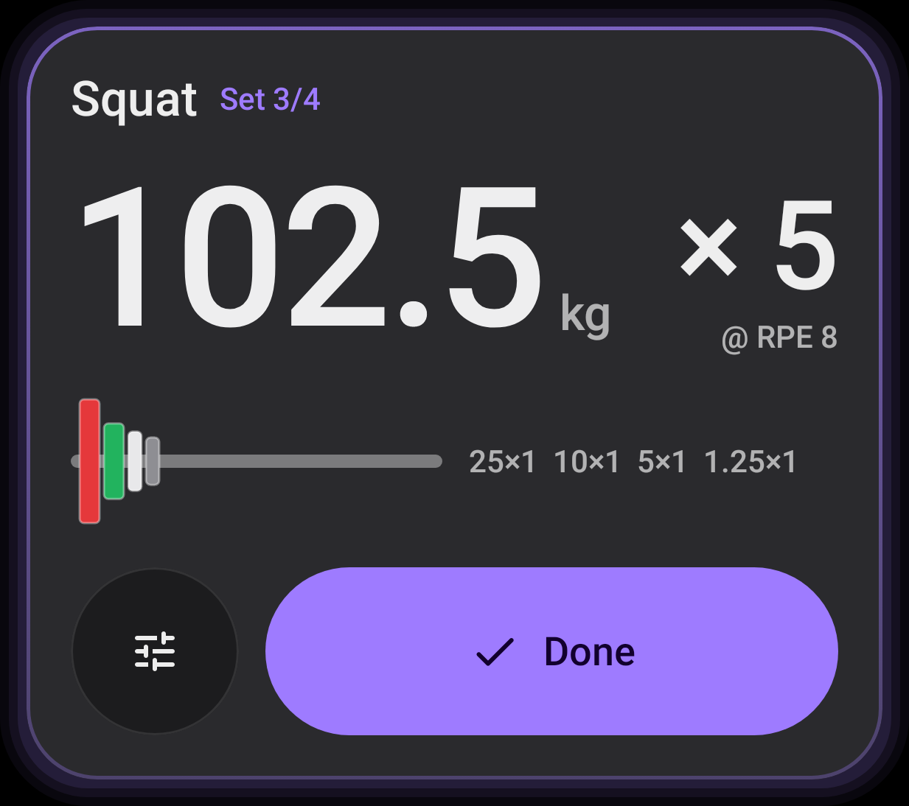
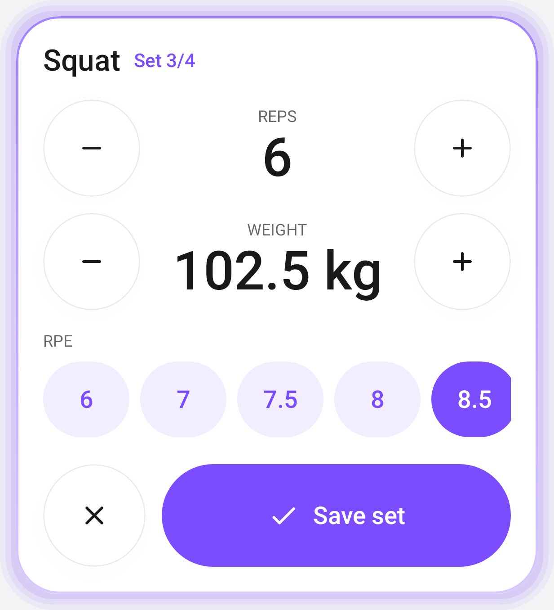
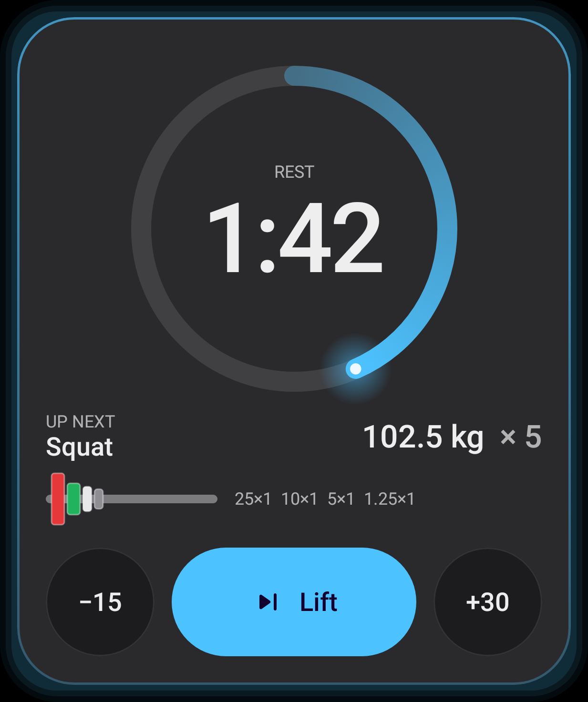
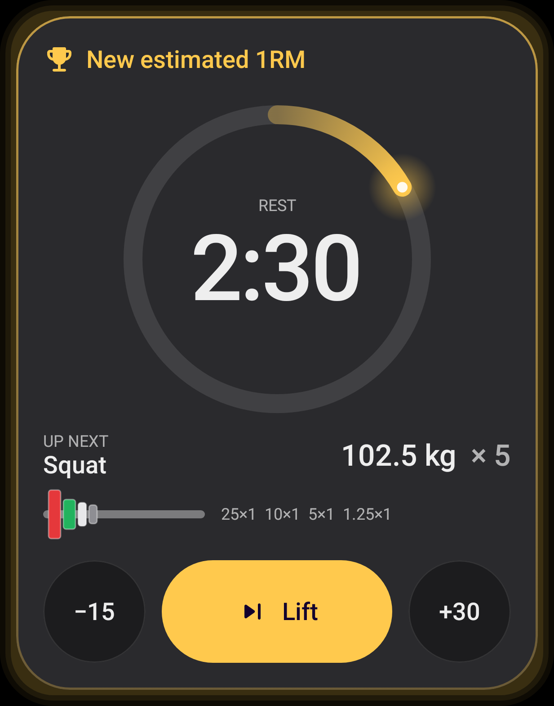

# LiftoDroid

An Android companion for [Liftosaur](https://www.liftosaur.com) built for the gym floor: a fast,
distraction-free **workout execution and tracking engine**. You build and edit programs and
Liftoscript in Liftosaur. LiftoDroid runs the workout: one-tap start, giant-target set logging,
plate math, a lock-screen rest timer, offline queueing, and progress charts.

> **Report what the lifter did; the server decides what it means.** LiftoDroid never runs
> progression. It sends completed sets to the Liftosaur REST API, and `POST /workout/finish` does the rest.

The UI is an original interpretation of the **Living Flow** design language (frosted-glass chrome,
light as state signal, spring-driven morphing), tuned for harsh lighting and sweaty thumbs.

<p>
  
  
  
  
</p>

*The Active Set & Rest Flow Card in Ready, Logging, Rest, and PR states, rendered from the real
composable by `SetFlowCardScreenshotTest` (Robolectric + Roborazzi). The renders use the opaque
reduce-transparency surfaces, because Robolectric can't do backdrop blur.*

## Design specification

| | |
|---|---|
| [1 · Architecture](docs/01-architecture.md) | Stack, data flow, workout state machine, offline-first sync and failure taxonomy, background execution |
| [2 · UI blueprint](docs/02-ui-blueprint.md) | Living Flow applied screen by screen, thumb-zone map, ASCII layouts, card states, motion and haptics table, accessibility checklist |
| [3 · API integration](docs/03-api-integration.md) | Endpoint contract, headers, sequences (online and fully offline), models, repository surface |

## Where the code is

| Deliverable | Path |
|---|---|
| Active Set & Rest Flow Card (Compose) | `app/src/main/java/app/liftodroid/ui/workout/ActiveSetFlowCard.kt` |
| Card state model (pure, unit-tested) | `app/src/main/java/app/liftodroid/ui/workout/SetFlow.kt` |
| Living Flow tokens and theme | `app/src/main/java/app/liftodroid/ui/theme/` |
| Glass, press, buttons, island, charts | `app/src/main/java/app/liftodroid/ui/components/`, `ui/shell/` |
| API models and client | `app/src/main/java/app/liftodroid/data/remote/` |
| Workout repository (start · set · sets drain · finish) | `app/src/main/java/app/liftodroid/data/WorkoutRepository.kt` |
| Room offline store | `app/src/main/java/app/liftodroid/data/local/` |
| Rest-timer foreground service and haptics | `app/src/main/java/app/liftodroid/session/` |

## Build & test

Requires JDK 17 and an Android SDK with platform 35 (set `sdk.dir` in `local.properties`).

```bash
./gradlew :app:testDebugUnitTest   # 29 JVM tests: sync, offline replay, merge, plates, history parsing, card states, screenshots
./gradlew :app:testDebugUnitTest --tests '*Screenshot*' -Proborazzi.test.record=true   # re-render docs/screens
./gradlew :app:assembleDebug       # → app/build/outputs/apk/debug/app-debug.apk
```

On first launch, paste a Liftosaur API key (`lftsk_…`, Premium) from Liftosaur → Settings.

## Status

Verified: the project compiles and the debug APK assembles. All unit tests pass, including the
full offline-start → queued sets → reconnect → remap → batch drain → finish scenario against a
mocked API.

Not yet verified (needs a device or emulator):

* visual polish of blur levels and glow intensities
* 200 % font scale
* frame rate on mid-range hardware
* notification behaviour across OEM skins

## Roadmap

* Settings screen: reduce-transparency toggle (the preference and theme plumbing exist), units override, sign out
* "Needs attention" sheet listing parked writes, with fix and resend
* Superset-aware set ordering
* Pause / resume with `intervals` on finish (the repository already accepts them)
* Wear OS tile mirroring the rest ring
