**Tested:** November 2026, on Android, with the Play Store version of each app on that day. Apps change, so a screenshot here shows how the app worked on the test day.

**Disclosure:** we're the ones building Liftosaur, which is also in this comparison. So we tried to make the test as boring and repeatable as possible - same script in each app, screenshots to back up each claim, and all the raw results below. And if some other app is a better fit for your needs - we'll tell you that.

## Short answer

GZCLP is a great program, but it's kinda annoying to run in most apps. Logging sets is not the tricky bit - the tricky bit is what happens when you miss reps on a T1 lift: 5x3+ turns into 6x2+, then 10x1+, and then you retest your 5RM. T2 does 3x10, 3x8, 3x6. And T3 bumps up the weight once you hit 25 reps on the AMRAP set.

We failed a T1 squat set on purpose in every app and looked at the next T1.

- **3 apps changed the stage automatically:** Liftosaur, Volm and GZCL Workout Logger.
- **4 apps have a GZCLP template, but you need to switch stages manually:** Boostcamp, KeyLifts, Hardy (community version) and Lyfta (community version).
- **6 workout loggers can store GZCLP as a routine,** but you'd need to keep track of the stages in your head: Strong, Hevy, FitNotes, JEFIT, StrengthLog, Caliber.
- **6 adaptive apps are designed for something else.** Fitbod, Alpha Progression, Gravl, MacroFactor Workouts, RP Hypertrophy and MyoAdapt generate the workouts for you. Those are good for that, but those are not GZCLP apps, and some of them even overwrite a manually created GZCLP day.

Our choice:

- **Liftosaur** follows GZCLP most closely. Starting weights come from your rep maxes, a miss on any set counts as a fail, and there's a guided 5RM test before the reload. Hints on the workout screen explain each stage as you get to it. It's also the easiest to customize: the whole program is one text, so T1, T2 and T3 rules each live in one place (e.g. bump T3 at 18 reps instead of 25 - one line).
- **Volm** is close behind, and miles ahead of everything below it. It runs the stage changes by itself too, but follows GZCLP a bit less precisely (lifts start at 0 lb, no 5RM test before the reload), and each lift has its own copy of the rule, so it's a bit harder to customize.
- **GZCL Workout Logger** is good enough if you want something free and simple, and you don't mind not having a backup or changing any rules.

## What a GZCLP app has to do

This is the checklist we tested against. It comes from the GZCLP rules, not from any app.

1. **Change the T1 stage after a failure.** 5x3+ -> 6x2+ -> 10x1+ with the same weight, and then retest 5RM and restart with 85%.
2. **Change the T2 stage after a failure.** 3x10 -> 3x8 -> 3x6, and then reset.
3. **Add weight after a success,** with different increments for upper and lower body exercises.
4. **Base T3 progression on the AMRAP set:** bump up the weight when the last set hits 25 reps.
5. **Handle T1, T2 and T3 differently.** E.g. the same exercise could be T1 on a day and T2 on another day, with separate weights.
6. **Mark the last set as AMRAP** (the "+" set).
7. **Start with sane weights,** not 0 lb for all sets.

## How we tested

- All apps ran on Android in November 2026, freshly installed from the Play Store, with a test account.
- We started with the free tier, then bought or trialed the paid tier, and ran the same tasks again. Cancelled all subscriptions right after that.
- All prices on this page are US Google Play prices on the test day. Prices in other countries may be different.
- If the app had GZCLP - we started it. If it didn't - we built Day 1 manually: T1 squat 5x3+, T2 bench 3x10, T3 lat pulldown 3x15+.
- We logged the T1 squat with the last set missed (e.g. 3, 3, 3, 3, 2), finished the workout, and opened the following T1 squat.
- We counted how much you have to fix by hand to make the next T1 correct: the taps to edit it, and what you have to work out yourself ("that was a fail", "the next stage is 6x2", "keep the same weight").
- Also, each app got a full teardown of the main use case it's built for, so this page doesn't judge e.g. Fitbod for being bad at a program it never claimed to run.

## Results

Who changes the T1 stage after a missed set:

| App | Stage change after a fail |
|---|---|
| [Liftosaur](#liftosaur) | The app does it |
| [Volm](#volm) | The app does it |
| [GZCL Workout Logger](#gzcl-workout-logger) | The app does it |
| [Boostcamp](#boostcamp) | You, about 10 taps |
| [KeyLifts](#keylifts) | You, 15 taps |
| [Hardy](#hardy) | You, 8 to 12 taps |
| [Lyfta](#lyfta) | You, 38 taps |
| [StrengthLog](#strengthlog) | You, about 8 taps |
| [Caliber](#caliber) | You, about 11 taps |
| [Strong](#strong) | You, about 16 taps |
| [Hevy](#hevy) | You, about 16 taps |
| [FitNotes](#fitnotes) | You, about 17 taps |
| [JEFIT](#jefit) | You, about 17 taps |
| [Fitbod](#fitbod) | Not a GZCLP app |
| [Alpha Progression](#alpha-progression) | Not a GZCLP app |
| [Gravl](#gravl) | Not a GZCLP app |
| [MacroFactor Workouts](#macrofactor-workouts) | Not a GZCLP app |
| [RP Hypertrophy](#rp-hypertrophy) | Not a GZCLP app |
| [MyoAdapt](#myoadapt) | Not a GZCLP app |

Below, each app has its own section with the details: whether GZCLP is in the app, what the next T1 looked like, what you fix by hand, tiers and price. Click an app name in the table to jump to it.

## Apps that run GZCLP for you

### Liftosaur

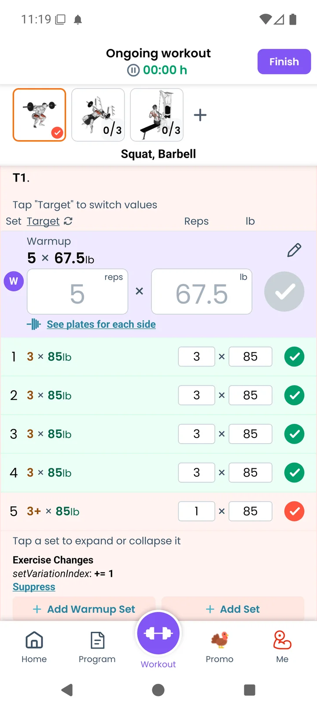

- **GZCLP in the app:** Included
- **Next T1 after a fail:** 6x2 stage, same weight
- **Fixing the next T1 by hand:** not needed, the app does it
- **Tiers:** Yes
- **Price to run GZCLP:** Free
- **Premium:** $4.99/month, $39.99/year or $99.99 lifetime

Liftosaur has [GZCLP](/programs/gzclp) built in, plus a Blacknoir version of it. It took like 10 taps to get from the first screen to having GZCLP as the current program. The first workout already has weights: T1 starts at about 85% of your 5RM, T2 and T3 lower, all from your rep maxes. If a weight feels off, you change it right in the workout.

We did only 1 rep on the 3+ set, and the T1 squat switched to the following stage, with the same weight. The workout screen showed that change right away, even without tapping Finish yet. T2 bench stayed 3x10, since it was a success. T1, T2 and T3 are separate templates, so you could have the same lift as T1 on some days and as T2 on others.

It follows the GZCLP rules closely: a miss on any set counts as a fail, squat and deadlift go up 10 lb while bench and overhead press go up 5 lb, and after 10x1 fails you get a 5RM test before the reload at 85%.

It also explains what to do right on the workout screen, and the hint changes with the stage. On the first T1 it tells you where the starting weight comes from and how to adjust it. On the retest day it walks you through finding a new 5RM step by step. So you don't need to keep the GZCLP rules in your head or in a Reddit tab.

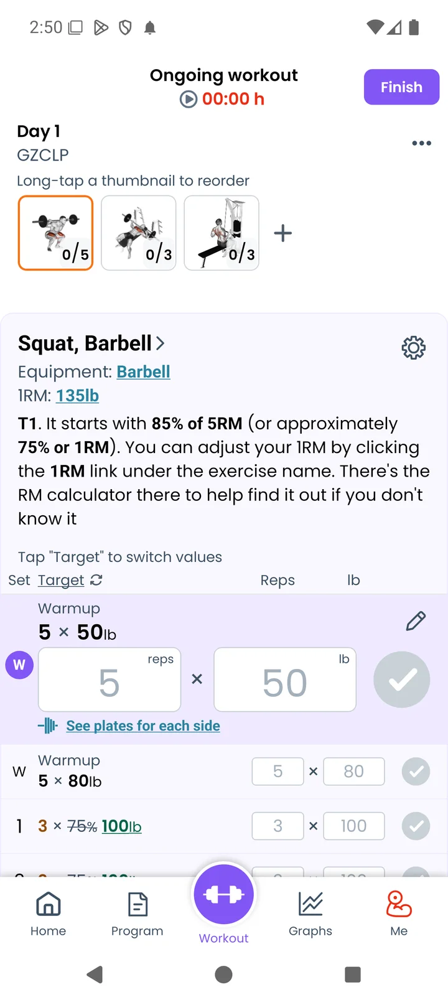 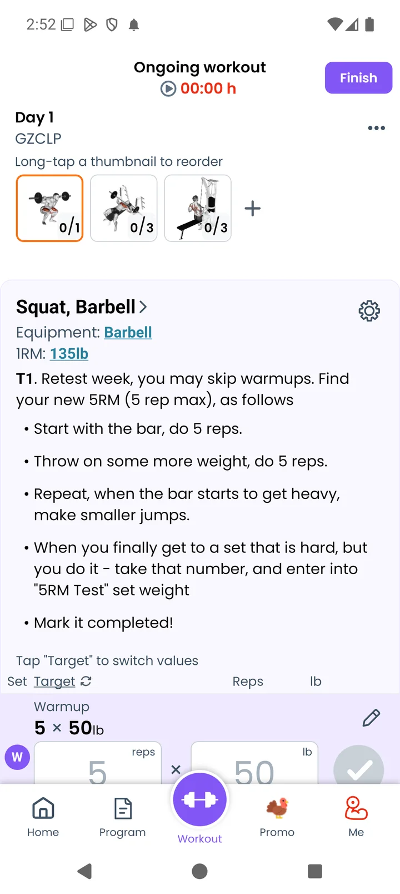

The whole program is one text in Liftoscript. T1, T2 and T3 rules are each written once and shared by every lift on that tier, so a change happens in one place. E.g. if you want T3 to increase the weight after 18 reps instead of 25, or want a different increment for overhead press - you just change one line. You never have to touch the text to run GZCLP as written, though. There're also other GZCL programs built-in - The Rippler, Jacked & Tan 2.0, UHF, VDIP, General Gainz and P-Zero, which is useful once GZCLP stops working for you.

For AI, Liftosaur connects to ChatGPT and Claude (Premium). The assistant can change almost every part of the app: read your history and write or change your program (e.g. "my T3s are stalling, change the rep target to 18"), log or fix a workout, set up your gym's plates and equipment, create custom exercises, record bodyweight and other measurements, and build dashboards.

Running GZCLP is free. Premium ($4.99/month, $39.99/year or $99.99 lifetime in the US) adds graphs, the plate calculator, rest timer notifications with a Live Activity on the lock screen, week insights, the Apple Watch app, and the ChatGPT/Claude integration.

### Volm

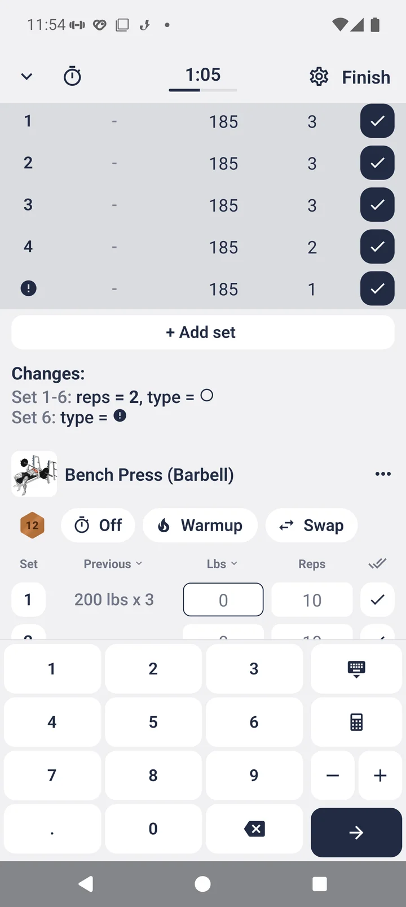

- **GZCLP in the app:** Included
- **Next T1 after a fail:** 6x2 stage, same weight
- **Fixing the next T1 by hand:** not needed, the app does it
- **Tiers:** Yes
- **Price to run GZCLP:** Free
- **Volm+:** $9.99/month or $59.99/year

Volm is a new app (first released in January 2026, about 70 App Store ratings and 1,000+ Android installs when we tested), and it's close behind Liftosaur here - way ahead of Boostcamp and every logger on this page. Its GZCLP program has the whole fail ladder: after we failed the T1 squat, the workout showed "Changes: Set 1-6: reps = 2", and Finish wrote 6x2 with the same weight into the Day 1 template. T2 and T3 have their own rules, and each day keeps its own weights, so squat can be T1 on Day 1 and T2 on Day 3. Rules can be changed with presets or a small script per exercise.

Where it follows GZCLP less precisely (we read its T1 rule):

- All lifts start at 0 lb, and Volm doesn't ask for your maxes, so you type a starting weight for every lift in the first week.
- Success is the total reps of all sets, so 3, 3, 3, 2, 5 counts as a success and adds weight, even though you missed a set.
- After 10x1 fails, it restarts at 85% of the weight you just failed, with no 5RM test.

It's also a bit harder to customize: each lift has its own copy of the rule, so changing the T1 ladder by hand means editing every T1 lift separately. The AI chat inside the app (Volm+) can do it for you though. We asked it to move T1 to the next stage only after 2 failed sessions in a row, and it rewrote the rule for all 4 T1 lifts correctly, one "Update Template" tap per day. But saving reset each lift's current stage (squat was still showing 6x2, while its rule went back to stage 1), and the readable rule sentence disappeared from those exercises.

### GZCL Workout Logger

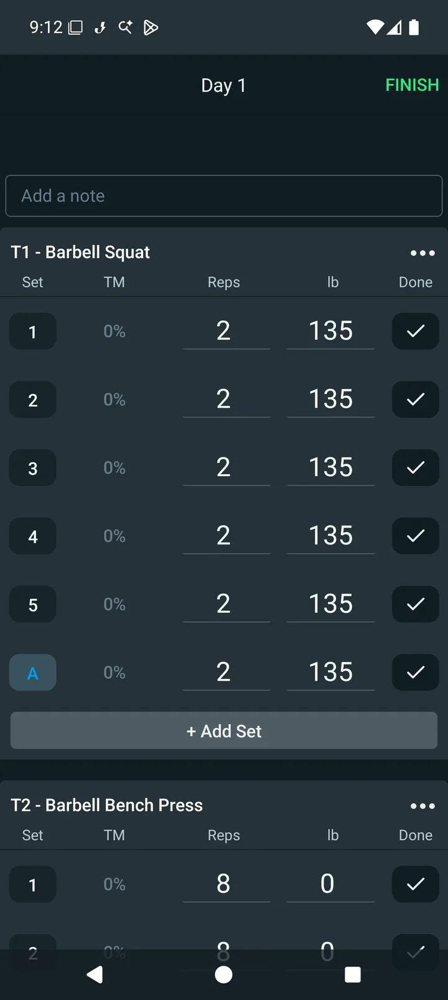

- **GZCLP in the app:** Included
- **Next T1 after a fail:** 6x2 stage, same weight
- **Fixing the next T1 by hand:** not needed, the app does it (you tap + and GZCLP once a week to load the next week)
- **Tiers:** Yes
- **Price to run GZCLP:** Free, no paid tier

A free app from the KeyLifts developer, it has GZCLP and GZCLP 3 Day included. It handled all the stage changes correctly - T1 switched to 6x2 with the same weight, and then +10 lb after a success. T2 did 3x10, 3x8, 3x6. And Deadlift T1 got down to 10x1.

The trade-offs:

- All weights start from 0 lb, and there isn't a training max or 1RM screen. So you type the weight for each set manually during the first cycle.
- There's neither an account nor a backup. The data is stored only on the phone.
- You can't change the rules. The only thing in Settings is "Reset Progressions".
- After each week, you tap + and then GZCLP to get the next week.

## Apps with a GZCLP template, but you do the stages

### Boostcamp

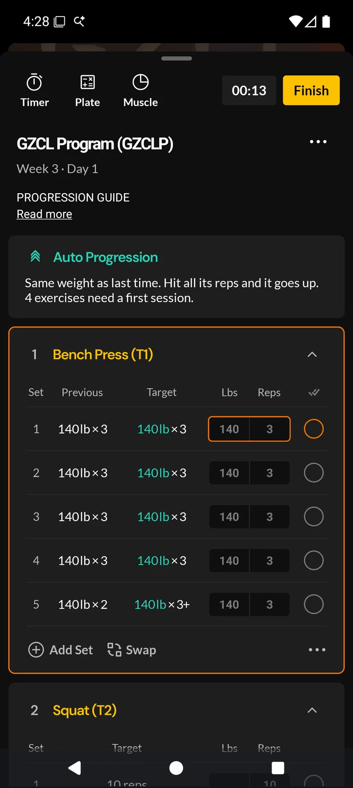

- **GZCLP in the app:** Included
- **Next T1 after a fail:** the same 5x3+ again
- **Fixing the next T1 by hand:** about 10 taps on every T1 workout, and you work out the next stage yourself
- **Tiers:** Only in the names
- **Price to run GZCLP:** Free (Auto Progression is PRO)
- **PRO:** $14.99/month or $79.99/year (we were also offered $39.99/year)

Boostcamp's GZCLP program has the most users of any GZCLP program we found in an app: its page says 40,210 athletes. Boostcamp has a great program catalog in general. But it doesn't actually follow GZCLP rules - after a missed 3+ set, our following T1 still stayed 5x3+. And 6x2 stage is only described in their Progression Guide.

PRO Auto Progression ($14.99/month or $39.99 to $79.99/year) adds one generic rule for all exercises: increase the weight if you complete all reps. So if you missed a T1 bench with 140 lb, it'd just repeat 140 lb. You'd have to edit each T1 workout manually (about 10 taps), and the template resets to 5x3+ each week.

If you want a big catalog of coach programs and you're fine tracking GZCLP stages yourself, Boostcamp is still a good app.

### KeyLifts

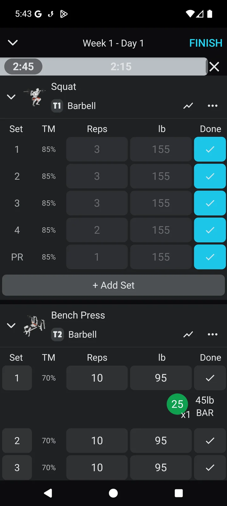

- **GZCLP in the app:** Verified template from a user
- **Next T1 after a fail:** 5x3+ again, +10 lb
- **Fixing the next T1 by hand:** 15 taps plus lowering the training max, and you work out the next stage yourself
- **Tiers:** Only as rep schemes
- **Price to run GZCLP:** 4 free workouts, then $29.99/year (the only plan shown)

KeyLifts is basically a 5/3/1 app. Their "GZCLP" is a verified user template, with 807 users. It uses a "Specific Week +10 lb" rule, so after we failed T1, TM still went higher anyway, and next T1 was 5x3+ with 165lb instead of 6x2 with old weight. To fix it, it took 15 taps, working out the stage yourself, and lowering the TM by hand. 4 free workouts, then $29.99/year.

### Hardy

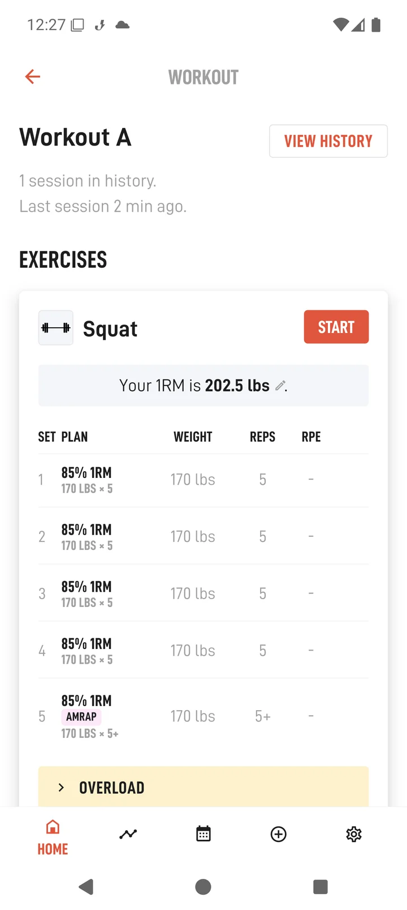

- **GZCLP in the app:** Community routine
- **Next T1 after a fail:** the same 5 sets
- **Fixing the next T1 by hand:** 8 to 12 taps, and you work out the next stage yourself
- **Tiers:** No
- **Price to run GZCLP:** Free
- **Hardy Pro:** $5.99/month, $59.99/year or $94.99 lifetime

Hardy has a big library of community routines, and there's a "GZCLP Program" there with 533 people training it. But it doesn't have any rules, and you have to manage the stages yourself - it's about 8 to 12 taps after a miss. Hardy has built-in rules (Overload, Deload, Double Progression) that can increase the weight or deload by 10%, but none of them can switch 5x3 to 6x2.

### Lyfta

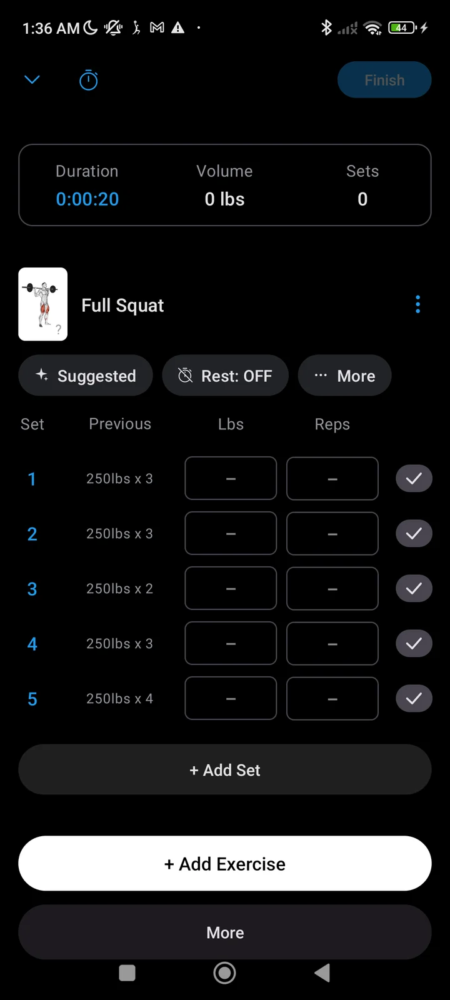

- **GZCLP in the app:** Community uploads
- **Next T1 after a fail:** suggests +5 lb
- **Fixing the next T1 by hand:** 38 taps, and you work out the next stage yourself
- **Tiers:** No
- **Price to run GZCLP:** Free for logging
- **Premium:** $59.99/year (a $16.99/month plan shows up as an exit offer)

Lyfta has 5 GZCLP programs from the community, all just regular routines without stages, rated from 0 to 2.3 stars. After the miss, Lyfta's Progression screen suggested +5 lb, and just copied over the failed reps. To run GZCLP properly, it took 38 taps during the workout.

## Workout loggers: GZCLP in your head

Strong, Hevy, FitNotes, JEFIT, StrengthLog, Caliber - they're good loggers, but none claims to run GZCLP, and none actually runs it. You'd have to build every day as a routine (like 20 to 45 taps per day), and then manage the stages manually.

After a missed T1 you need to:

1. realize you failed (usually those apps won't even tell you that),
2. remember what stage goes after that,
3. leave weight as it was,
4. update your routine - add one more set, and change reps for 6 sets.

That took 8 taps in StrengthLog, and 16 to 17 in Strong, Hevy, FitNotes and JEFIT. Hevy and JEFIT also copy the failed reps into the routine by default, which means the following workout would plan the miss again (3, 3, 2, 3, 3). And Caliber's plans don't even have a weight field, so you'd have to keep the weight in mind as well.

If you like any of those apps, running GZCLP in a logger is totally fine. A bunch of people on r/gzcl run it from a spreadsheet, and that's pretty much the same thing.

None of the 6 has GZCLP in the app or T1/T2/T3 tiers, and all 6 are free to run it.

### StrengthLog

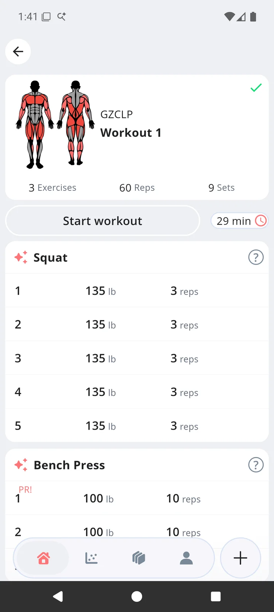

- **Next T1 after a fail:** the same 5x3
- **Fixing the next T1 by hand:** about 8 taps, and you work out the next stage yourself
- **Premium:** $16.99/month, $37.99 per 3 months or $109/year

### Caliber

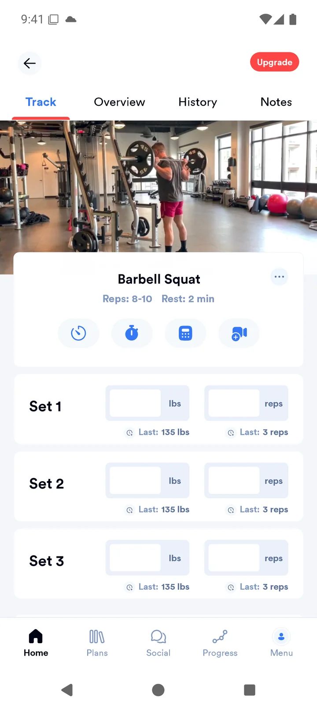

- **Next T1 after a fail:** the same plan, with empty weights
- **Fixing the next T1 by hand:** about 11 taps, and you work out the next stage and the weight yourself
- **Caliber Plus:** $12/month or $72/year

### Strong

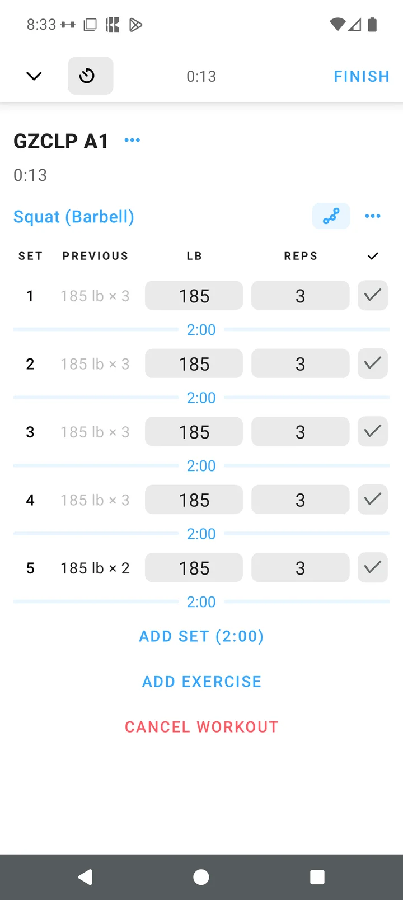

- **Next T1 after a fail:** the same 5x3
- **Fixing the next T1 by hand:** about 16 taps, and you work out the next stage yourself
- **PRO:** $4.99/month, $29.99/year or $99.99 lifetime

### Hevy

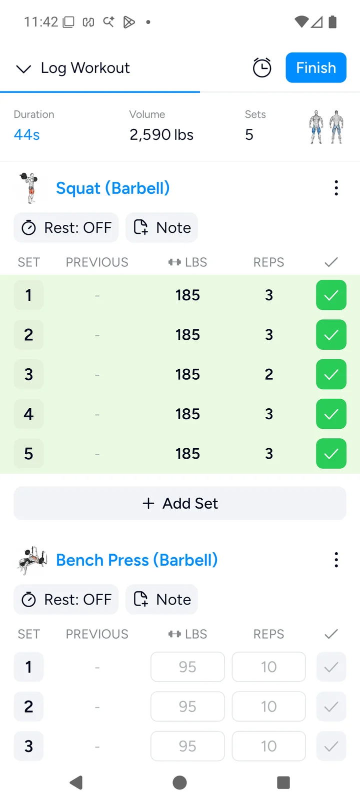

- **Next T1 after a fail:** copies the failed sets (3, 3, 2, 3, 3)
- **Fixing the next T1 by hand:** about 16 taps, and you work out the next stage yourself
- **PRO:** $2.99/month, $23.99/year or $74.99 lifetime

### FitNotes

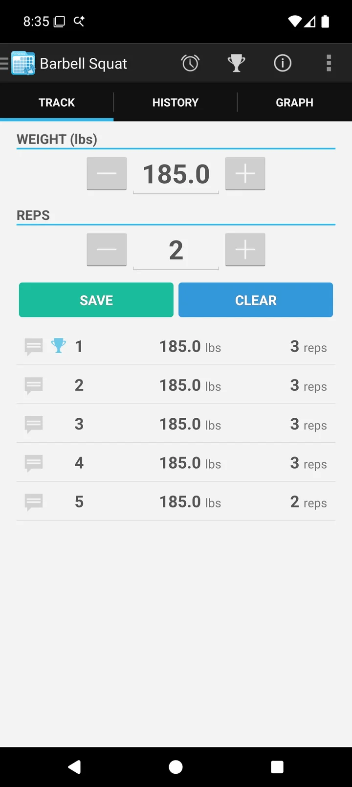

- **Next T1 after a fail:** the same 5x3
- **Fixing the next T1 by hand:** about 17 taps, and you work out the next stage yourself
- **Price:** Free, with an optional $6.99 one-time Supporter app

### JEFIT

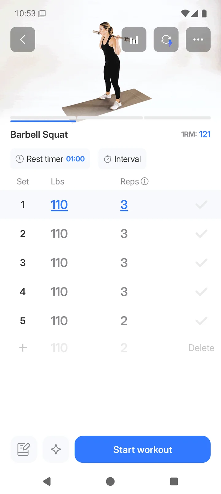

- **Next T1 after a fail:** copies the failed sets (3, 3, 3, 3, 2)
- **Fixing the next T1 by hand:** about 17 taps, and you work out the next stage yourself
- **Elite:** $12.99/month or $69.99/year

## Adaptive apps: built for something else

Fitbod, Alpha Progression, Gravl, MacroFactor Workouts, RP Hypertrophy and MyoAdapt generate the workouts for you and then adjust them based on the results. We tested every app with the plan it generates, and several actually do that job pretty well. But it's a totally different approach to lifting than GZCLP, and you notice that pretty quickly when you try to squeeze a fixed program into them:

- Gravl replaced a 5x3 we stored there with different sets it came up with when we reopened it.
- RP Hypertrophy calculates the weights and number of sets for the next week via the built-in engine.
- MacroFactor Workouts doesn't have a weight field in the program editor - Smart Progression picks all the weights.
- There's no way to build a routine in MyoAdapt.

If you'd rather let the app make those decisions for you, go with one of these instead of GZCLP. But if you're planning to run GZCLP - these are not the right tools for that.

None of the 6 has GZCLP in the app or T1/T2/T3 tiers.

### Fitbod

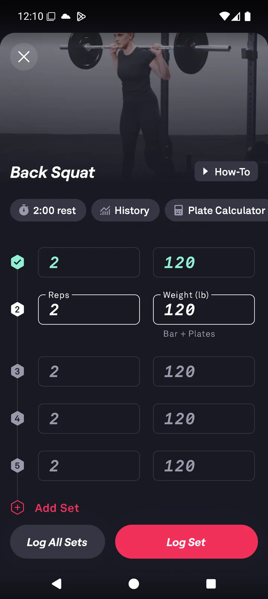

- **Next T1 after a fail:** the app picks it (3x6)
- **Price:** Paid. We didn't see the plan prices; Google Play lists items from $9.99 to $179.99

### Alpha Progression

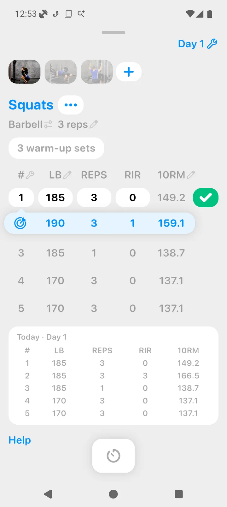

- **Next T1 after a fail:** copies the last session
- **Price:** $14.99/month or $89.99/year, needed for the suggestions

### Gravl

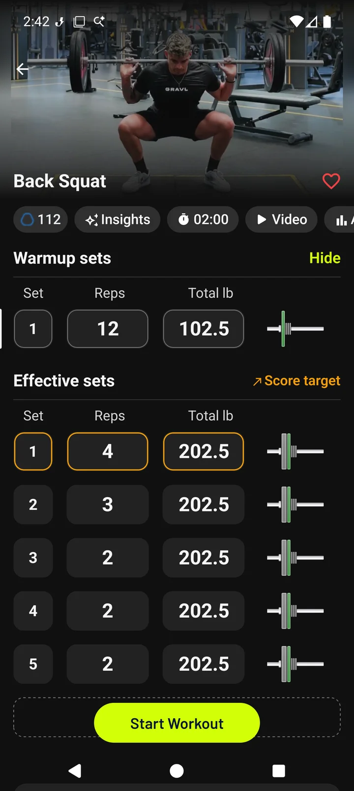

- **Next T1 after a fail:** the app picks it
- **Price:** $10.99/month or $69.99/year

### MacroFactor Workouts

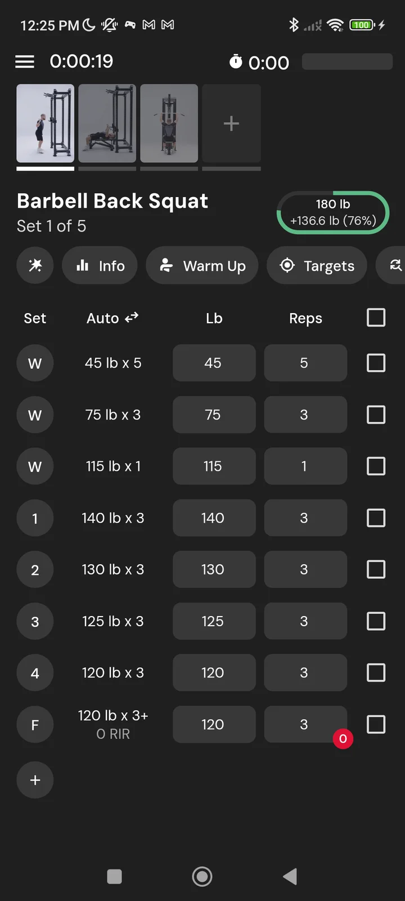

- **Next T1 after a fail:** Smart Progression changes the sets
- **Price:** $11.99/month, $47.99 per 6 months or $71.99/year, 7-day trial

### RP Hypertrophy

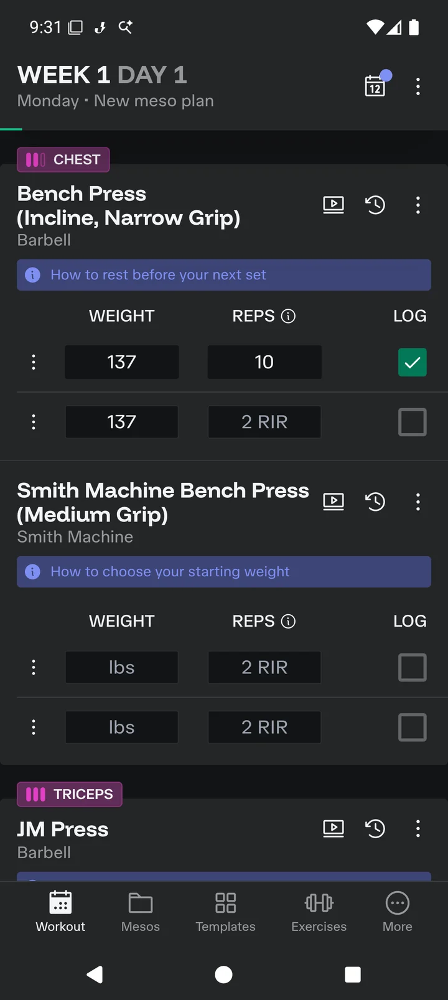

- **Next T1 after a fail:** the app sets it the next week
- **Price:** $34.99/month or $299.99/year

### MyoAdapt

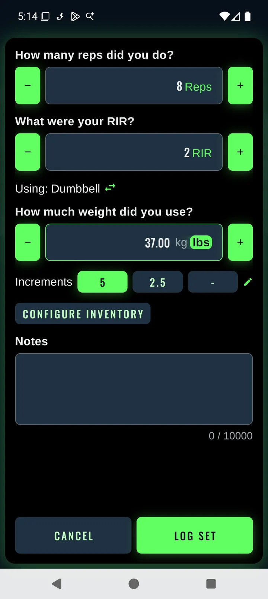

- **Next T1 after a fail:** the app picks it
- **Fixing the next T1 by hand:** not possible, GZCLP can't be set up there
- **Price:** $22/month or $220/year, 7-day trial

## When another app is better

- **You want an AI chat inside the app:** Volm runs GZCLP almost as well, with a few simplifications.
- **You want free, simple, and nothing else:** GZCL Workout Logger - if you're okay with not having a backup.
- **You want a huge catalog of coach programs and don't mind doing stages manually:** Boostcamp.
- **You log everything in Strong or Hevy and like it:** just keep using it, and track the stages in a note/spreadsheet.
- **You don't want to stick to any program whatsoever:** some adaptive app, like MacroFactor Workouts / Alpha Progression.

## FAQ

### Does Boostcamp change GZCLP stages automatically?

No. In our test the T1 stayed 5x3+ after a miss, on free and on PRO. The stage change is only described in the Progression Guide text.

### Is there a free app that runs GZCLP properly?

Yes - Liftosaur, Volm and GZCL Workout Logger, all of them switched the stage automatically, and you don't need to pay for it.

### Can I change the GZCLP rules, e.g. the T3 rep target?

Yes, in Liftosaur and Volm. In Liftosaur the whole program is one text, and each tier's rule is written once, so one edit changes every T1 (or T2, or T3) lift. In Volm each lift has its own copy of the rule, so you edit them one by one. GZCL Workout Logger can't do that. And the rest of the apps don't have any GZCLP rules to change in the first place.

### Which app follows GZCLP most closely?

Liftosaur. In our test it was the only app that did all of these: started with real weights, counted a miss on any set as a fail, used bigger increments for squat and deadlift, and ran a 5RM test before the reload. Volm and GZCL Workout Logger also change the stages by themselves, but start every lift at 0 lb.

### Is Volm good for GZCLP?

Yes, it's one of the 3 apps that change the stages for you, and it's far ahead of Boostcamp or a plain logger. It simplifies a few rules though: lifts start at 0 lb, success counts total reps (so one missed set can still pass), and the reload after 10x1 is 85% of the failed weight, without a 5RM test.

### Does Hevy or Strong support GZCLP?

You can create GZCLP there with routines, but neither of them switches stages for you or tells you that you missed an AMRAP. And Hevy by default just copies the failed reps to the routine.

### What should I run after GZCLP?

Typically it's [The Rippler](/programs/gzcl-the-rippler) or [Jacked & Tan 2.0](/programs/gzcl-jacked-and-tan-2) - both are by the same author, and both are available in Liftosaur.
