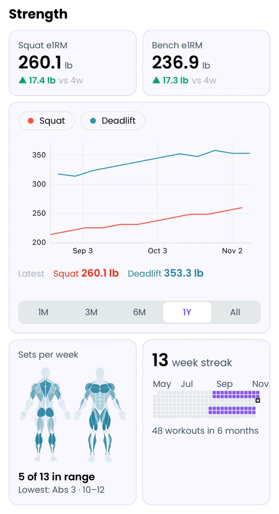
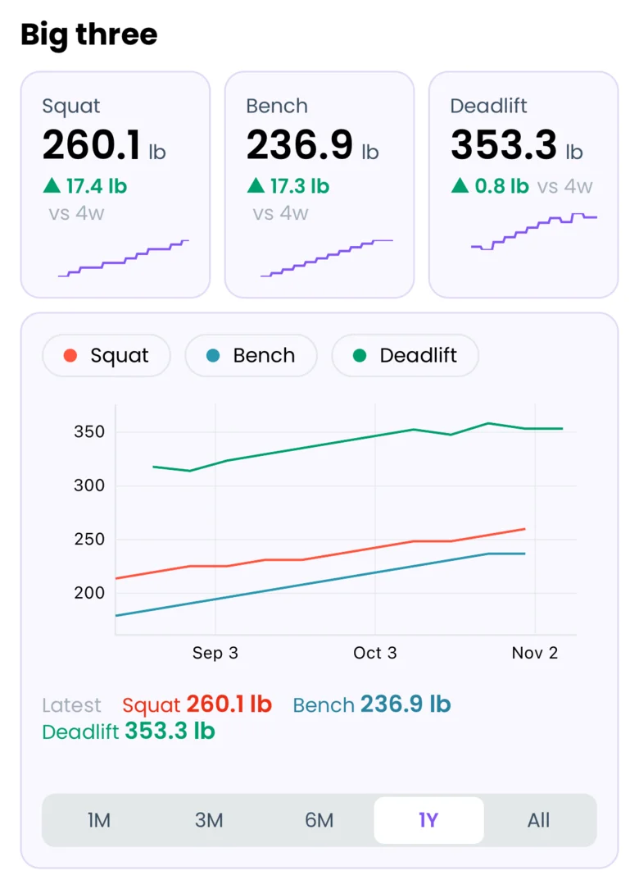
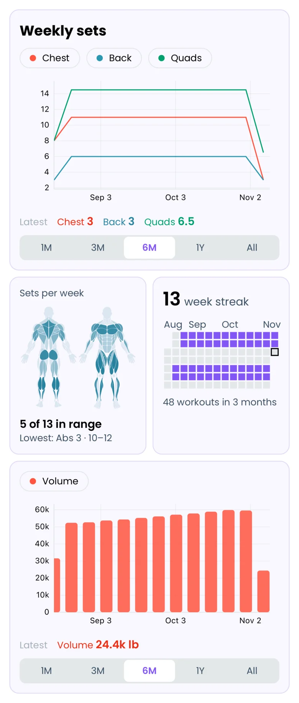
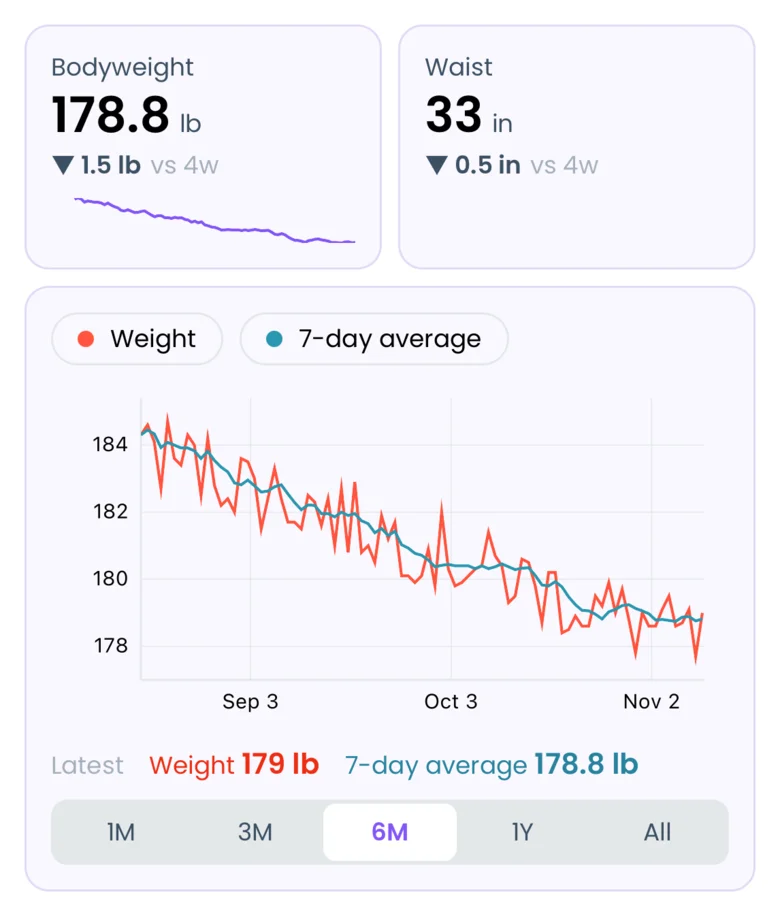
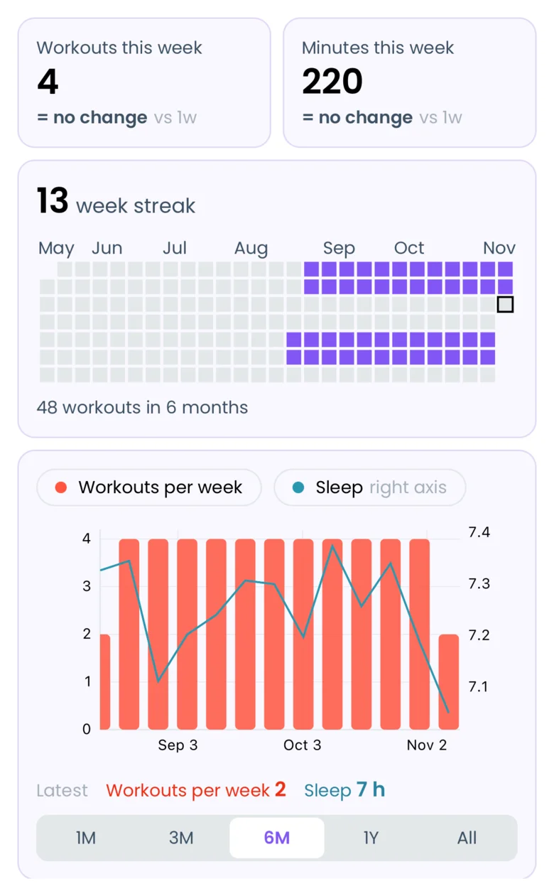

### Contact Us

If you have any questions, write to us at <a href="mailto:info@liftosaur.com">info@liftosaur.com</a>!

## What Liftograph is

The **Graphs** tab in Liftosaur shows a **dashboard**: a page of graphs, numbers, a muscle map and a training calendar.

Every dashboard is stored as a short piece of text, written in a small language called **Liftograph**.

The **Edit dashboard** screen also has settings forms that write the text for you. See [Graphs and Dashboards](/features/graphs). An AI assistant like ChatGPT or Claude can write a whole dashboard from a description. See [Using AI with Liftosaur](/features/chatgpt-claude-and-ai). Your own formulas work only in text.

### Where to type it

1. Open the **Graphs** tab.
2. Tap the pencil at the top right. The **Edit dashboard** screen opens.
3. Tap the text button at the top right. It is the second of the two buttons there.
4. Type your dashboard. Tap **Save** when you are done.

The editor suggests what to type next. It marks mistakes and tells you what is wrong.

To add another dashboard, tap the dashboard name at the top of the **Graphs** tab, then **New dashboard**. Tap a name in the same list to switch dashboards. You can have up to 20.

## A first dashboard

```liftograph
// ## Strength
row {
  value / name: Squat e1RM / source: exercise(Squat) / y: e1rm / compare: 4w
  value / name: Bench e1RM / source: exercise(Bench Press) / y: e1rm / compare: 4w
}

graph / range: 1y {
  name: Squat / source: exercise(Squat) / y: e1rm
  name: Deadlift / source: exercise(Deadlift) / y: e1rm
}

row {
  muscles / range: 7d / show: map
  calendar / range: 6m
}
```



From top to bottom, it shows:

- A heading, "Strength".
- A row with two big numbers side by side. Each one is your current e1RM, with the change over the last 4 weeks. e1RM means estimated one rep max: the weight you could lift for 1 rep, calculated from your sets.
- A graph of your squat and deadlift e1RM over the last year.
- A row with a body map of last week's sets, and a calendar of your workouts in the last 6 months.

The next sections explain each part: how a line works, the four widgets, rows, text, and series.

## How a line works

Liftograph is written line by line. Spaces at the start of a line don't matter. Blank lines between widgets don't matter either. They only change how text works, see **Text, headings and captions**.

A **widget** is one block on the page. A widget line starts with its kind, then has settings separated by slashes (`/`):

```
graph / range: 1y
```

Each setting is a name, a colon, and a value: `range: 1y`. The order of the settings doesn't matter.

Some widgets hold more lines inside `{ }`. A graph holds its lines there, one per line of text (see **Series**). A row holds the widgets that go side by side (see **Rows**).

### Time periods

Many settings take a period of time: a number and a letter.

- `d` for days, like `14d`.
- `w` for weeks, like `8w`.
- `m` for months, like `3m`.
- `y` for years, like `1y`.

`all` means your whole history.

### Quotes

Names you type yourself go in double quotes when they contain one of `,` `/` `(` `)` `:` `{` `}` `"`. That covers exercise names, `name:` labels and program names. For example, a custom exercise named "Row (Chest Supported)" is written like this:

```
source: exercise("Row (Chest Supported)")
```

The brackets and commas that are part of the syntax itself, like `exercise(Squat, Barbell)` or `max(1w)`, never take quotes.

To split a long line in two, end the first part with `\`. The next line continues it.

## Widgets

There are four kinds of widget: `graph`, `value`, `muscles` and `calendar`. Text is the fifth thing you can put on a page.

### graph

A graph shows one or more lines over time. Each line is a **series**. The series go inside `{ }`, one per line of text:

```liftograph
graph / range: 6m {
  name: Weight / source: exercise(Bench Press) / y: maxWeight
  name: e1RM / source: exercise(Bench Press) / y: e1rm
}
```

- `range:` how much time the graph shows when it opens, ending today. Without it, the graph shows all your history. On the Graphs tab, the **1M**, **3M**, **6M**, **1Y** and **All** buttons still switch it.

For the settings of each series, see **Series**.

### value

A value shows one big number, such as your current e1RM or your bodyweight. A value has exactly one series, and its settings go right on the `value` line:

```liftograph
value / name: Bench e1RM / source: exercise(Bench Press) / y: e1rm / compare: 4w / trend: 3m
```

The number is the latest point of the series. When the series uses `smooth:` over a time period, the period ends today. So `smooth: count(7d)` on a `workout` source shows how many workouts you did in the last 7 days.

- `compare:` shows how much the value changed since that long ago, like "▲ 7.5 kg vs 4w". It can be up to `10y`, and can't be `all`.
- `trend:` draws a small chart of the value over that time, under the number. It can be up to `1y`, and can't be `all`.

### muscles

A muscles widget shows how many sets each muscle group got per week, as a body map, a list, or both. It has no series.

```liftograph
muscles / range: 4w / show: map, sets(chest, lats, quadriceps)
```

- `range:` how far back to count, ending today. The numbers are always per week, so `range: 4w` shows the weekly average over the last 4 weeks. Without it, the range is the last 7 days, which is also the shortest range.
- `show:` what to draw. `map` is the body map. `sets` is the list. `map, sets` is both, and is what you get without `show:`.
- `sets(chest, lats)` limits the list to those muscle groups, in that order. The names are listed in **Muscle groups**.
- `source:` counts only some workouts, for example `source: workout(program: GZCLP)`. See **Where the data comes from**.

### calendar

A calendar shows one square per day. A colored square is a day with a finished workout. At the top, it shows your week streak: how many weeks in a row you finished at least one workout.

```liftograph
calendar / range: 6m
```

- `range:` how many days to show, ending today. Without it, the calendar shows the last 3 months.

## Rows

A widget on its own line takes the full width of the screen. To put widgets side by side, wrap them in `row { }`:

```liftograph
row {
  value / name: Squat / source: exercise(Squat) / y: e1rm
  value / name: Bench / source: exercise(Bench Press) / y: e1rm
  value / name: Deadlift / source: exercise(Deadlift) / y: e1rm
}
```

A row holds 1 to 4 items, and each item gets an equal share of the row. Each kind needs a minimum share:

- `value` and text need a quarter of the row. Up to 4 fit in one row.
- `graph`, `muscles` and `calendar` need half of the row. Up to 2 fit in one row.

## Text, headings and captions

A line that starts with `//` is text that the app shows on the page. It can use Markdown:

- `**bold**` and `_italic_`.
- `## Heading` for a heading.
- `- item` for a list.
- `[text](https://example.com)` for a link.

Where you put the text changes what it does:

- Text directly above a widget or a row, with no blank line between, is its **caption**.
- Text followed by a blank line is a separate block of text. Inside a row, it takes a quarter of the row, like a `value`.

A line that starts with `///` is a note for yourself. The app does not show it.

```liftograph
/// My main lifts.
// **Training days, last 6 months**
calendar / range: 6m
```

## Series

A series is the data behind one line of a graph, or behind the number of a value. A series line looks like this:

```
name: Squat / source: exercise(Squat) / y: e1rm / group: max(1w)
```

- `source:` picks where the data comes from.
- `y:` picks the number to take from each record.
- `group:` and `smooth:` shape the line. Both are optional.
- `name:`, `mark:`, `axis:` and `color:` set how the line looks.

### Where the data comes from

Each source gives a list of **records**: one per workout with that exercise, one per workout, or one per logged measurement. Each record becomes one point on the graph.

- `exercise(Squat)` reads every workout where you did that exercise.
- `exercise(Squat, Barbell)` picks the equipment. Without it, the exercise's default equipment is used.
- `exercise(Squat, label: T1)` reads only the squats labeled T1 in your program, like `t1: Squat / 3x5`.
- `exercise(Squat, program: "5/3/1", day: 2)` reads only the squats from that program, and from day 2 of it. You can use either filter on its own.
- `workout` reads your whole workouts, one record per workout. It takes the same filters: `workout(program: GZCLP, day: 1)`.
- `stats(weight)` reads one of your measurements, one record per entry you logged.

The exercise name must match an exercise in Liftosaur: a built-in one, or one of your custom exercises. A series for an exercise you never logged has no points, so its line stays empty. That is not a mistake in the text.

The measurements you can use in `stats( )`:

- Bodyweight: `weight`.
- Body fat percentage: `bodyfat`.
- Body measurements: `neck`, `shoulders`, `bicepLeft`, `bicepRight`, `forearmLeft`, `forearmRight`, `chest`, `waist`, `hips`, `thighLeft`, `thighRight`, `calfLeft`, `calfRight`.
- From Apple Health or Health Connect: `sleep` in hours, `calories` in kcal, and `protein` in grams. See [Health Sync](/features/health-sync).

### What number to plot

`y:` picks the number to take from each record:

- `maxWeight`: the heaviest weight you lifted in that exercise in that workout. This is the default for an `exercise` source.
- `e1rm`: the best estimated one rep max of that workout.
- `volume`: weight × reps, added up over all sets. This works for an `exercise` or a `workout`, and is the default for a `workout`.
- `maxReps`: the most reps you did in one set.
- `muscleSets(chest)`: how many sets the chest got in that workout. Use it with a `workout` source.
- `muscleVolume(chest)`: the volume for the chest in that workout. Use it with a `workout` source.
- `duration`: how long the workout took, in minutes. Use it with a `workout` source.
- `value`: the measurement itself. This is the default for a `stats` source, so you can leave `y:` out.

### Shaping the line

Without shaping, a graph has one point per record. `group:` and `smooth:` change that. The app applies `y:` first, then `group:`, then `smooth:`.

**`group:`** joins all the points in one period into a single point. You write how to join them, then the period:

- `group: max(1w)` keeps the best value of each week.
- `group: sum(1w)` adds up each week.
- `group: avg(1m)` takes the average of each month.
- `group: count(1w)` counts the points in each week. With a `workout` source, that is workouts per week.

The ways to join are `max`, `min`, `sum`, `avg`, `last` and `count`. Here the period is a calendar week or month. Weeks start on the day set in **Week starts from** in **Me → Settings**.

`muscleSets` and `muscleVolume` give one point per workout. For a total per week, add `group: sum(1w)`:

```liftograph
graph / range: 6m {
  name: Chest sets per week / source: workout / y: muscleSets(chest) / group: sum(1w)
}
```

**`smooth:`** evens out a jumpy line. It keeps every point, but replaces each one with a summary of the points up to it:

- `smooth: avg(5)` gives the average of the last 5 points.
- `smooth: avg(7d)` gives the average of the last 7 days. Use it for bodyweight, which goes up and down from day to day.
- `smooth: count(7d)` counts the points in the last 7 days.

The ways to smooth are `avg`, `sum`, `count`, `max` and `min`. The period can be up to `10y`, and can't be `all`.

```liftograph
graph / range: 6m {
  name: Weight / source: stats(weight)
  name: 7-day average / source: stats(weight) / smooth: avg(7d)
}
```

### How the line looks

- `name:` the name in the legend. A value shows it above the number.
- `mark:` `line`, `bars` or `dots`. The default is `line`. Bars always start at 0.
- `axis:` `left` or `right`. Put a series on the right axis when its numbers are very different from the others, like bodyweight next to a squat.
- `color:` `red`, `blue`, `green`, `orange`, `purple` or `gray`.

```liftograph
graph / range: 3m {
  name: Protein / source: stats(protein) / group: avg(1w) / mark: bars
  name: Bodyweight / source: stats(weight) / group: avg(1w) / axis: right / color: green
}
```

### Muscle groups

These are the names to use in `muscleSets( )`, `muscleVolume( )` and `show: sets( )`:

`chest`, `lats`, `upperBack`, `frontDelts`, `sideDelts`, `rearDelts`, `biceps`, `triceps`, `quadriceps`, `hamstrings`, `glutes`, `calves`, `abs`, `upperTraps`, `lowerBack`, `neck`, `rotatorCuff`, `forearmFlexors`, `forearmExtensors`, `obliques`, `hipFlexors`, `abductors`, `adductors`.

Your own custom muscle groups work too. `muscleSets(total)` and `muscleVolume(total)` count all muscle groups together. `total` does not work in `show: sets( )`.

## Example dashboards

Copy one of these into the text editor and change it to fit your training. Replace any exercise you don't do with one you do.

### Powerlifting

```liftograph
// ## Big three
row {
  value / name: Squat / source: exercise(Squat) / y: e1rm / compare: 4w / trend: 3m
  value / name: Bench / source: exercise(Bench Press) / y: e1rm / compare: 4w / trend: 3m
  value / name: Deadlift / source: exercise(Deadlift) / y: e1rm / compare: 4w / trend: 3m
}

graph / range: 1y {
  name: Squat / source: exercise(Squat) / y: e1rm / group: max(1w)
  name: Bench / source: exercise(Bench Press) / y: e1rm / group: max(1w)
  name: Deadlift / source: exercise(Deadlift) / y: e1rm / group: max(1w)
}
```



### Hypertrophy

```liftograph
// ## Weekly sets
graph / range: 6m {
  name: Chest / source: workout / y: muscleSets(chest) / group: sum(1w)
  name: Back / source: workout / y: muscleSets(lats) / group: sum(1w)
  name: Quads / source: workout / y: muscleSets(quadriceps) / group: sum(1w)
}

row {
  muscles / range: 7d / show: map
  calendar / range: 3m
}

graph / range: 6m {
  name: Volume / source: workout / y: volume / group: sum(1w) / mark: bars
}
```



### Body composition

```liftograph
row {
  value / name: Bodyweight / source: stats(weight) / smooth: avg(7d) / compare: 4w / trend: 3m
  value / name: Waist / source: stats(waist) / compare: 4w
}

graph / range: 6m {
  name: Weight / source: stats(weight)
  name: 7-day average / source: stats(weight) / smooth: avg(7d)
}
```



### Consistency

```liftograph
row {
  value / name: Workouts this week / source: workout / smooth: count(7d) / compare: 1w
  value / name: Minutes this week / source: workout / y: duration / smooth: sum(7d) / compare: 1w
}

calendar / range: 6m

graph / range: 6m {
  name: Workouts per week / source: workout / group: count(1w) / mark: bars
  name: Sleep / source: stats(sleep) / group: avg(1w) / axis: right
}
```



### A program's T1 and T2 squats

For programs like GZCLP, where the same lift appears as T1 and T2:

```liftograph
graph / range: 1y {
  name: T1 / source: exercise(Squat, label: T1) / y: maxWeight
  name: T2 / source: exercise(Squat, label: T2) / y: maxWeight
}
```

## Common mistakes

The editor shows each mistake with the line it is on. The most common ones:

- **Unknown exercise 'X'.** The name doesn't match any exercise in Liftosaur. Check the spelling, or pick the exercise from the suggestions.
- **Unknown stat 'X'.** Use one of the measurement names listed in **Where the data comes from**.
- **Unknown key 'X'.** A setting name has a typo, or this kind of widget doesn't have that setting.
- **A `y:` that doesn't match the source.** For example, `source: stats(weight) / y: e1rm`. A measurement has no e1RM.
- **A row holds at most 4 items.** Or a widget doesn't fit in its row. A graph, muscles or calendar widget needs half of the row.
- **A name contains one of `,` `/` `(` `)` `:` `{` `}` `"`.** Put it in double quotes, like `name: "Squat / BW"`.
- **An empty graph with no mistake shown.** You have no records for that source yet, for example an exercise you never logged.

Each dashboard can be up to 64 KB of text.

## Your own formulas

When none of the `y:` options gives the number you want, you can write a script instead. Scripts use the same language as program progressions, called Liftoscript. See [Liftoscript](/doc/liftoscript) for how it works.

The script goes at the end of a series line, between `{~` and `~}`. It runs once for every record, from oldest to newest. Inside it, `point(y)` adds a point with the value `y`.

How scripts work:

- If the script doesn't call `point()` for a record, that record adds no point. So an `if` around `point()` skips records.
- `var.` variables start fresh for every record. `state.` variables keep their value from one record to the next, and start at 0.
- Most values are lists with one entry per set. `for (var.i in completedReps)` goes through the sets, and `completedReps[var.i]` reads one of them.
- `max`, `min`, `sum`, `avg` and `count` turn a list into one number: `max(e1rm)` is the biggest e1RM among the sets. You can also use `floor`, `ceil`, `round`, `calculate1RM(weight, reps)` and `rpeMultiplier`.
- `point(x, y)` puts a number on the bottom axis instead of a date. All series in one graph must use the same form. With numbers on the bottom axis, `group:` takes no period, like `group: max`, and `smooth:` takes a number of points.

What you can read in an `exercise` record:

- `completedWeights`, `weights` and `e1rm`: one weight per set.
- `completedReps`, `reps`, `minReps`, `completedRPE` and `RPE`: one value per set.
- `numberOfSets`, `completedNumberOfSets`, `volume`, `bodyweight` and `rm1`.
- `day`, `week` and `dayInWeek`: where the workout was in the program.
- `exercise`: the name of the exercise. `isExercise("Squat")` and `isProgramExercise("t1: Squat")` check it.
- `programState("rm1")`: a program state variable, as it was saved with that workout.

A `workout` record has the same per-set values for every set of the workout. It also has `duration` in minutes, `exercises` (how many exercises), `muscleSets("chest")`, `muscleVolume("chest")`, `isSetExercise(i, "Squat")` and `isSetProgramExercise(i, "t1: Squat")`.

A `stats` record has `value` and `bodyweight`.

When data is missing, Liftograph leaves a gap instead of using 0. Math with a gap gives a gap, and `point()` with a gap adds no point. For example, `bodyweight` is a gap before your first weigh-in.

This graph counts the sets of squats at RPE 8 or harder, per week:

```liftograph
graph {
  name: Hard sets / source: exercise(Squat) / group: sum(1w) / mark: bars {~
    var.hard = 0
    for (var.i in completedRPE) {
      if (completedRPE[var.i] >= 8) { var.hard += 1 }
    }
    point(var.hard)
  ~}
}
```

This one shows your squat e1RM divided by your bodyweight:

```liftograph
graph {
  name: "Squat / BW" / source: exercise(Squat) / smooth: avg(5) {~ point(max(e1rm) / bodyweight) ~}
}
```

This one shows the heaviest weight you lifted for each number of reps:

```liftograph
// **Squat: best weight per rep count, last 12 months**
graph / range: 1y {
  name: Squat / source: exercise(Squat) / group: max {~
    for (var.i in completedReps) { point(completedReps[var.i], completedWeights[var.i]) }
  ~}
}
```
