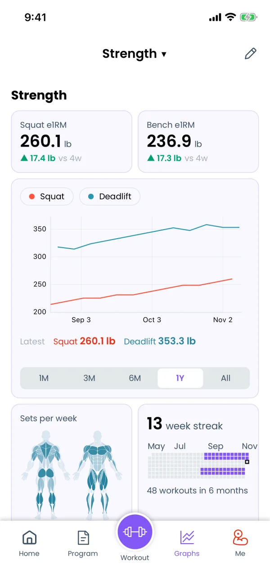
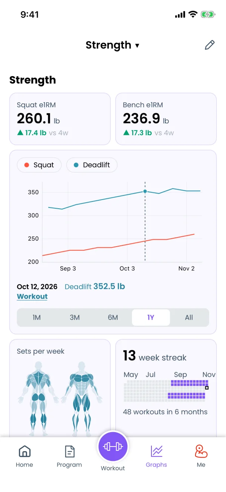
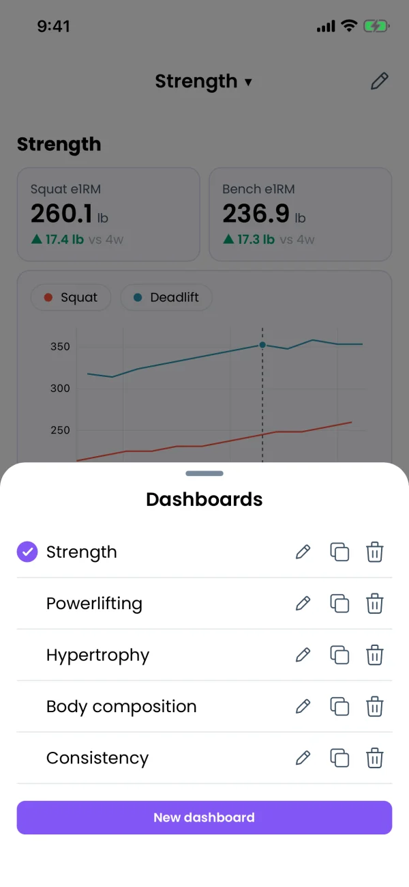
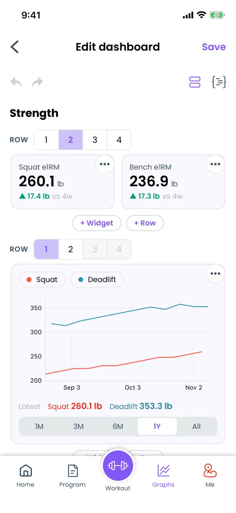
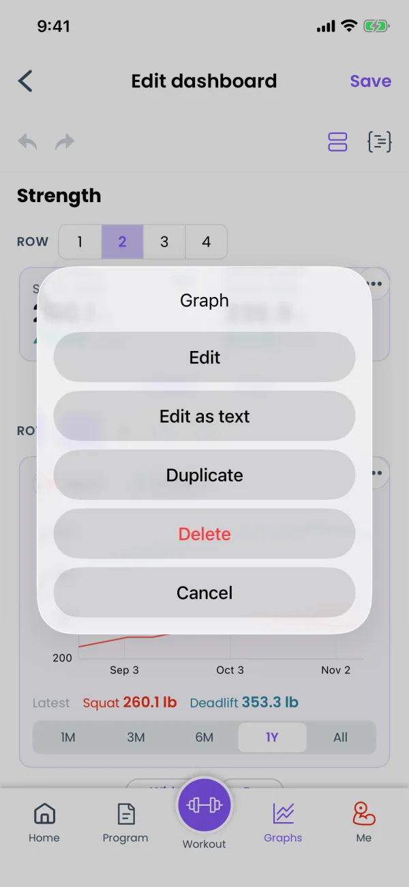
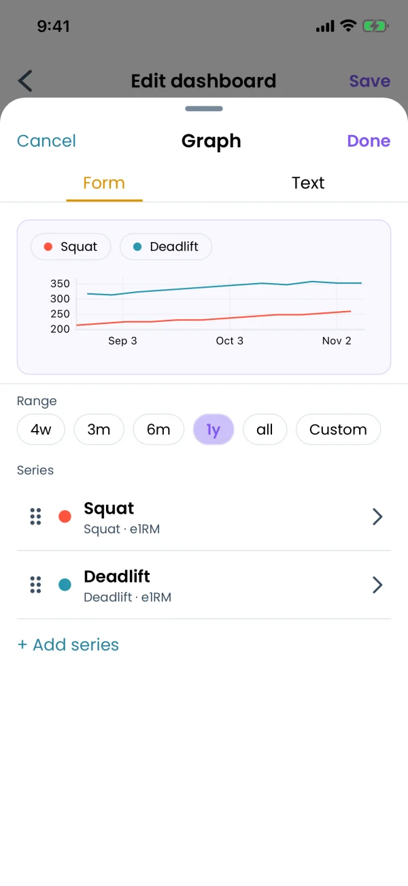
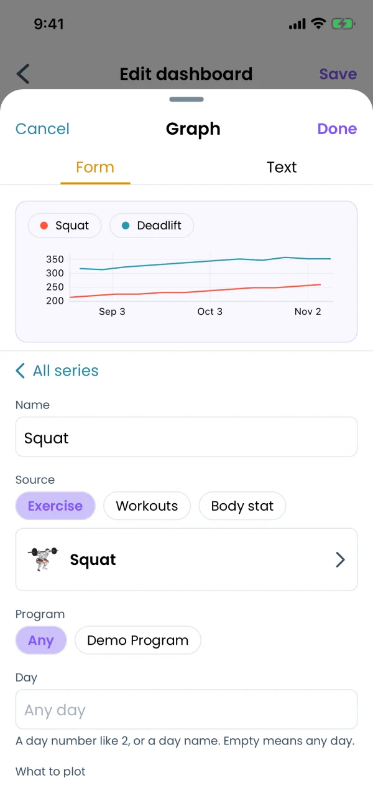
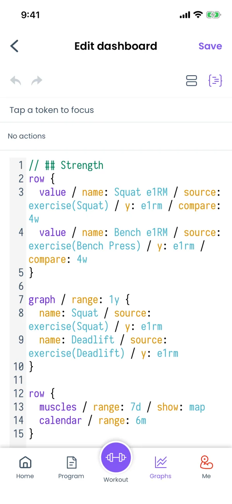
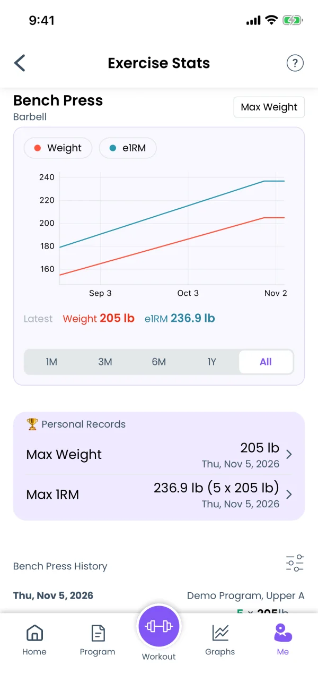

## What the Graphs tab shows



Tap **Graphs** in the footer. Graphs are a Premium feature. Without Premium, the tab opens the subscription screen instead.

The Graphs tab shows one **dashboard**: a page of **widgets**, placed in rows from top to bottom. A widget is one block on the page, like a graph or a number.

There are five kinds of widget:

- **Graph**. Lines, bars or dots over time, like your squat e1RM (estimated one rep max) for the last year.
- **Value**. One big number, like your current bench e1RM, with the change since an earlier date.
- **Muscles**. A body map and a list of how many sets each muscle group got per week.
- **Calendar**. One square per day. Days with a finished workout are colored.
- **Text**. Your own headings and notes between the widgets.

The name of the dashboard is at the top of the screen. If you used graphs before dashboards came out, the app moved your old graphs into a dashboard named **Graphs**. An empty dashboard says "This dashboard is empty. Tap the pencil to add graphs."

## Reading a graph



Each graph has a legend at the top, with one chip per line. Tap a chip to hide that line, and tap it again to show it.

Under the graph, the app shows the latest value of each line, marked **Latest**.

Touch the graph, hold for a moment, then slide your finger. The values under the graph change to the point under your finger, with its date. If the point comes from a workout, a **Workout** link appears. Tap it to open that workout.

The buttons **1M**, **3M**, **6M**, **1Y** and **All** under the graph change the time range until you leave the screen. To change the range the graph opens with, edit the widget.

To zoom:

- Pinch with two fingers to zoom in or out.
- Drag with two fingers to move along the dates.
- Double-tap the graph to reset the zoom.

## Reading the other widgets

**Value.** The big number is the latest value. Under it, an arrow shows the change, for example "▲ 7.5 vs 4w": the value is 7.5 higher than 4 weeks ago. Green means the change is good for you, red means it is bad. A value can also have a small chart under the number, called the trend.

**Muscles.** The body map colors each muscle by how many sets it got per week. The list next to it or under it gives the exact sets per week for each muscle group.

Liftosaur counts only sets you finished. A set counts once for its target muscles. For synergist muscles (muscles that help), it counts by the synergist multiplier from your settings. To change which muscles an exercise trains, open the exercise from **Me → Exercises** and tap **Override Muscles**.

**Calendar.** Each square is one day. A colored square is a day with a finished workout, and the outlined square is today. The number at the top is your week streak: how many weeks in a row you finished at least one workout.

The line at the bottom counts your workouts in the range, like "24 workouts in 6 months". The week starts on Monday or Sunday, following **Week starts from** in **Me → Settings**.

## Keep several dashboards



You can have up to 20 dashboards. For example, one for strength, one for bodyweight and diet, and one for your current program.

Tap the dashboard name at the top of the Graphs tab. The **Dashboards** sheet opens. In it you can:

- Tap a dashboard to switch to it.
- Rename, duplicate or delete it with the buttons on its row.
- Tap **New dashboard** to make an empty one. The app opens it for editing right away.

You can't delete your only dashboard.

## Edit a dashboard



Tap the pencil at the top right of the Graphs tab. The **Edit dashboard** screen opens. It shows your widgets as tiles, with your real data in them.

Changes are saved only when you tap **Save** at the top right. If you go back without saving, the app asks "Discard unsaved changes to this dashboard?". The arrows at the top left undo and redo your changes.

### Rows

Every widget sits in a row. Above each row, **ROW** has the buttons **1**, **2**, **3** and **4**. They set how many columns the row has. A row with 2 columns puts two widgets side by side.

Graph, Muscles and Calendar widgets need at least half of the row, so a row holds at most 2 of them. Value and Text widgets need a quarter, so a row holds up to 4. When a widget does not fit, the app greys out that column count.

### Add a widget

- Tap **+ Widget** under a row to add a widget in a new row. Then pick its kind.
- Tap **+ Row** to add an empty row with 2 columns.
- Tap **+ Widget** in an empty column to fill that column.

### Change, copy, move or delete a widget



Tap the **•••** button on a tile. The menu has:

- **Edit**. Opens the widget settings.
- **Edit as text**. Opens the text editor at this widget.
- **Duplicate**. Adds a copy of the widget.
- **Delete**. Removes the widget.

To move a widget, touch the tile and hold for half a second, then drag it. A purple line shows where it will land. A red line means it does not fit there.

## Widget settings



Tap **Edit** in the tile menu. A sheet opens with a preview of the widget at the top. The preview changes as you change the settings. **Done** keeps the changes and **Cancel** drops them. The **Text** tab shows the same widget as text.

The fields depend on the kind of widget.

### Graph

- **Range**. The time range the graph opens with: **4w**, **3m**, **6m**, **1y**, **all**, or **Custom**, like `8w`. Here `w` means weeks, `m` months and `y` years.
- **Series**. The lines on the graph. Tap a series to change it. Drag the handle on its left to change the order. Tap **+ Add series** to add another line.



Each series has these fields:

- **Name**. The name in the legend.
- **Source**. Where the data comes from. **Exercise** is one exercise from your workouts. **Workouts** is all your workouts together. **Body stat** is a measurement, like bodyweight, body fat, waist, or sleep, calories and protein from health sync.
- **Label**, **Program** and **Day**. Filters for Exercise and Workouts sources, for example only the sets from one program, or only from day 2. Empty means any.
- **What to plot**. For an exercise: **Max weight**, **e1RM**, **Volume** or **Max reps**. For workouts: **Volume**, **Sets per muscle**, **Volume per muscle** or **Duration**. For a body stat: **Value**.
- **Group**. Joins the points in one period into a single point. For example, **Sum** with a period of 1 week gives one point per week with the total. **None** keeps one point per workout.
- **Smooth**. Evens out a jumpy line. Each point becomes the average, max or another summary of the points before it. **None** draws every point as it is.
- **Mark**. **Line**, **Bars** or **Dots**. **Auto** picks one for you.
- **Axis**. **Left** or **Right**. Put a series on the right axis when its numbers are very different from the others, like bodyweight next to a squat.
- **Color**. The color of the line.

e1RM is the weight you could lift for 1 rep, calculated from a heavier set with more reps. It is the same number as the **e1RM** column on the workout screen. See [Logging a Workout](/features/workout-screen).

### Value

A value has the same series fields as a graph, without Mark, Axis and Color. It also has:

- **Compare with**. Shows the change since that long ago, like "▲ 7.5 vs 4w". **None** shows only the number.
- **Trend**. Draws a small chart of that period under the number. **None** hides it.

### Muscles

- **Range**. How far back to count sets. The shortest range is 7 days. The numbers are always per week, so a range of 4 weeks shows the weekly average over those 4 weeks.
- **Show**. **Map and sets**, **Map**, or **Sets**.
- **Muscle groups in the sets list**. Pick which groups the list shows. **All** shows every group.

### Calendar

- **Range**. How many days the calendar shows, like 3 or 6 months.

### Text

Tap **Edit** to change the text. It can use **bold**, _italic_, headings, lists and links (Markdown).

## The text editor



Every dashboard is stored as text, in a small language called Liftograph. The settings screens write this text for you, so you can use dashboards without ever reading it.

On the **Edit dashboard** screen, the two buttons at the top right switch between the tiles and the text. The text of the dashboard at the top of this page:

```
// ## Strength
row {
  value / name: Squat e1RM / source: exercise(Squat) / y: e1rm / compare: 4w
  value / name: Bench e1RM / source: exercise(Bench Press) / y: e1rm / compare: 4w
}

graph / range: 1y {
  name: Squat / source: exercise(Squat) / y: e1rm
  name: Deadlift / source: exercise(Deadlift) / y: e1rm
}

row {
  muscles / range: 7d / show: map
  calendar / range: 6m
}
```

A line that starts with `//` is text. The other lines are widgets. `row { ... }` puts the widgets inside it side by side. The full syntax is in [Liftograph](/doc/liftograph).

The editor suggests what to type next and marks mistakes. If the saved dashboard has a mistake, the Graphs tab shows a red message at the top. Tap the message to open the text editor and fix it.

Your own formulas for what to plot work only in text. A widget that uses one shows the text in its settings, with an **Edit as text** button.

## Ask an AI assistant to build a dashboard

Describe the dashboard to ChatGPT or Claude, for example: "Make me a dashboard with my bench and squat e1RM, weekly sets for chest and back, and my bodyweight." The assistant writes the dashboard, checks it against your data, and saves it. It shows up on your Graphs tab right away. See [Using AI with Liftosaur](/features/chatgpt-claude-and-ai) for how to connect one.

## Personal records for one exercise



Every exercise also has its own **Exercise Stats** screen. Open it from **Me → Exercises** and tap the exercise, or tap the exercise name during a workout.

The screen shows a graph of the exercise. The button at its top right switches between **Max Weight** and **Volume**. Below the graph, the **Personal Records** card lists your **Max Weight** and **Max 1RM**, each with the date. Tap a record to open that workout. The exercise history follows below.

Without Premium, the graph on this screen is blurred and does not respond to touch. The personal records stay visible.
